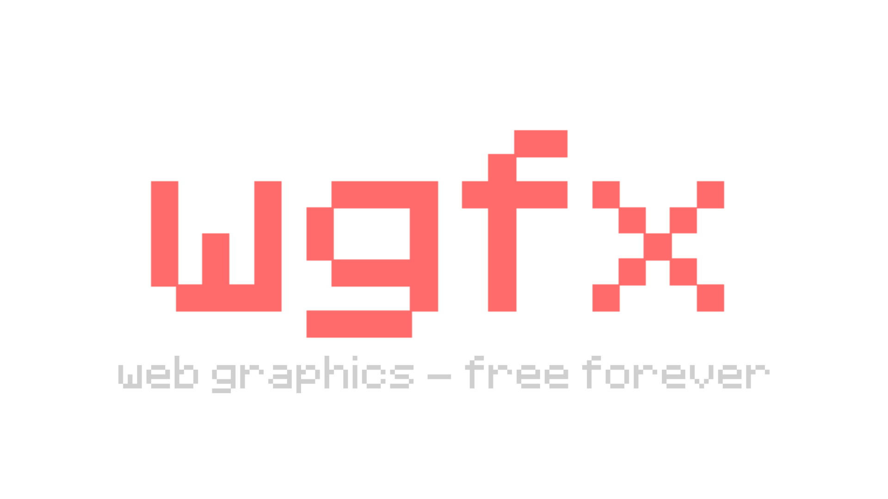
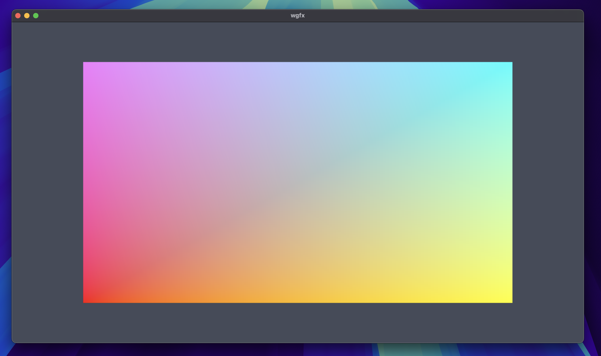
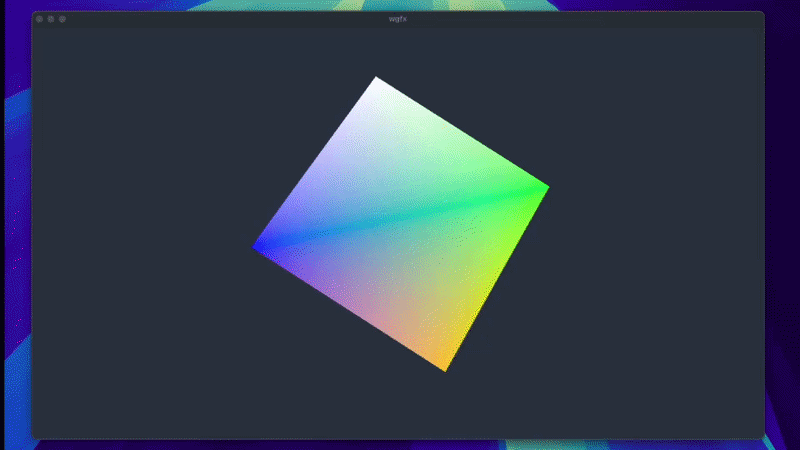

# wgfx



wgfx is a lightweight C++ WebGPU graphics framework focused on practical rendering and compute workflows.

This branch holds the library (`src/`), its WebGPU dependency (`deps/webgpu`), the optional SDL-to-WebGPU bridge, and CMake wiring. Runnable C++ samples are maintained on the **`examples`** branch so the default clone stays small.

## Screenshots






## Examples branch

```bash
git fetch origin examples
git checkout examples
```

There you will find the runnable sample applications and their assets.

## Build

```bash
cmake -S . -B build
cmake --build build
```

On this branch the configure step builds only the core `wgfx` library and WebGPU dependency by default.

## Performance evidence

Order-controlled comparisons against equivalent raw WebGPU calls find no
material steady-state wrapper overhead for compute encoding, buffer updates,
submission, or render encoding. The benchmark source, five raw runs, summary,
methodology, and typeset technical note are committed in this repository:

- [Performance report](PERFORMANCE.md)
- [Benchmark source](benchmarks/wgfx_benchmark.cpp)
- [Technical note](docs/wgfx-performance-evidence.tex)

Build the optional benchmark with:

```bash
cmake -S . -B build-benchmark -DWGFX_BUILD_BENCHMARKS=ON
cmake --build build-benchmark
./build-benchmark/wgfx_benchmark results.csv
```

wDoom is included in the report as a real compute-rendering consumer with a
four-demo, pixel-perfect validation corpus. It complements rather than replaces
the controlled raw-versus-wgfx measurements.

## Licensing

`wgfx` is dual-licensed:
* **Open Source / Non-Commercial:** Licensed under the GNU AGPLv3. If you use `wgfx` in an open-source project, it's 100% free.
* **Commercial:** If you want to use `wgfx` in a closed-source commercial project, game, or proprietary application, the AGPLv3 terms do not apply, and you must acquire a commercial license. Contact `ethan34787@gmail.com` for pricing details.
